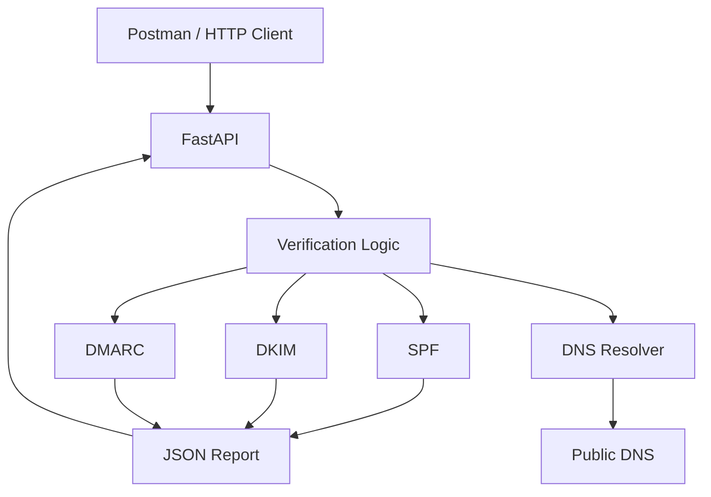

# DomainAuth

**Async SPF, DKIM, and DMARC verification API built with FastAPI.**

DomainAuth is a DNS authentication verification service for multi-tenant email platforms. It provides an HTTP API and a reusable Python interface for checking sender domains and determining their email-sending readiness.

## Features

- **SPF verification** — parses existing records, checks provider authorization and the 10-DNS-lookup limit.
- **DKIM verification** — generates key pairs and verifies published public keys.
- **DMARC verification** — validates policies and provides configuration hints.
- **DNS error handling** — distinguishes missing records from temporary failures.
- **Structured results** — returns `valid`, `missing`, `mismatch`, `conflict`, or `unknown` statuses.
- **Async DNS resolution** — uses public DNS resolvers without blocking the application.

## Architecture



## Getting Started

### Installation

```bash
git clone https://github.com/andrewmahalias/domainauth.git
cd domainauth

python3 -m venv .venv
source .venv/bin/activate

pip install -e ".[dev]"
```

### Run the API

```bash
uvicorn app.main:app --reload
```

API documentation:

- Swagger UI: http://127.0.0.1:8000/docs
- ReDoc: http://127.0.0.1:8000/redoc

### Test with Postman

Send HTTP requests to the verification endpoints and inspect the JSON responses. Request parameters and schemas are documented in Swagger UI.

## Python Usage

```python
from domainauth import DnsPythonResolver, generate_dkim_keypair, verify_domain

private_pem, dkim_value = generate_dkim_keypair()

report = await verify_domain(
    "example.de",
    DnsPythonResolver(),
    spf_include="spf.provider.example",
    dkim_selector="selector1",
    dkim_expected=dkim_value,
)

print(report.sending_ready)
print(report.spf.status, report.spf.hint)
```

## Testing

Tests use an in-memory `FakeResolver`, so no external DNS access is required.

```bash
pytest
```

## Design

- DNS resolution is abstracted through a `Protocol`.
- Temporary DNS failures return `unknown`, not `missing`.
- SPF lookup counting follows `include` and `redirect`.
- Long DKIM TXT values are split into DNS-compatible chunks.
- Retry scheduling and persistence are left to the integrating application.

## Limitations

- No background scheduling or retry mechanism.
- No persistence of verification results.
- No SPF macro expansion or full `ip4`/`ip6` matching.
- No organizational-domain DMARC fallback.
- No DKIM message signing; this is handled by the email delivery provider.

---

**Author:** Andrii Mahalias
